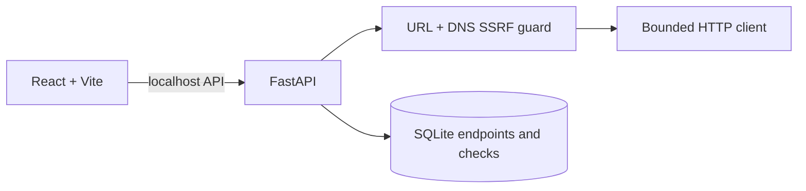

# APIWatch

> Local API health and performance monitoring for development teams.

APIWatch registers public HTTP(S) endpoints, runs on-demand health checks, records availability/status/latency in SQLite, and presents live dashboard analytics. It does not require an account, API key, or cloud service.

## Architecture



## Features

- Endpoint registration (`GET`, `HEAD`, `POST`) with adjustable 1–30 second timeout.
- Manual individual and bulk checks; failures do not stop bulk checks.
- Availability, status, latency, error, check history, and dashboard statistics.
- Live response-time charts and result history based entirely on recorded checks.
- SSRF controls: HTTP(S) only, no credentials in URLs, blocks localhost/private/link-local/reserved/non-public DNS records and known metadata hosts, validates redirect targets, 1 MB response cap, and no response-content execution.

## API

`GET /api/health`, `GET/POST /api/endpoints`, `GET/DELETE /api/endpoints/{id}`, `POST /api/endpoints/{id}/check`, `POST /api/check-all`, `GET /api/endpoints/{id}/history`, `GET /api/dashboard/stats`.

## Run

```powershell
cd backend
python -m venv .venv
.\.venv\Scripts\python -m pip install -r requirements.txt
.\.venv\Scripts\uvicorn app.main:app --reload --port 8000
```

```powershell
cd frontend
pnpm install
pnpm dev
```

Open `http://localhost:5173`; API docs are on `http://127.0.0.1:8000/docs`.

## Testing

```powershell
cd backend; .\.venv\Scripts\python -m pytest -q
cd frontend; pnpm run build
```

Tests exercise health, CRUD, private-target rejection, successful check recording, history/statistics, and bulk-check resilience.

## Limitations

This is a local manual monitor, not a production scheduler or uptime SLA service. DNS rebinding cannot be eliminated solely in application code; deploy only in a trusted network and retain network egress controls. Browser screenshots are not included because none are fabricated.

## Publish

Create an empty remote repository, then run `git remote add origin <url>`, `git add .`, `git commit -m "feat: build APIWatch"`, and `git push -u origin main`.
